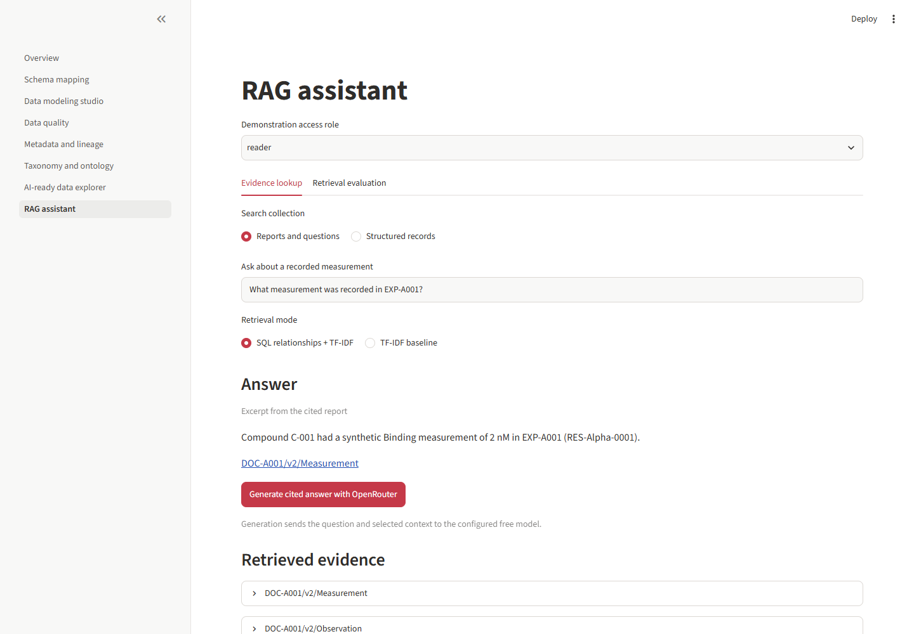

# R&D AI-Ready Data Platform

An interactive Streamlit demo for mapping synthetic screening results into a shared research schema. All example identifiers and measurements are fictional. The quality rules apply to these fixtures. This prototype has no GxP validation.

## Run locally

From the repository root in PowerShell, use Python 3.12 and the project environment.

```powershell
py -3.12 -m venv .venv
.\.venv\Scripts\python.exe -m pip install -r requirements-dev.txt
.\.venv\Scripts\python.exe -m streamlit run app.py
.\.venv\Scripts\python.exe -m pytest -q
```

## Mapping workflow

Open Schema mapping, inspect the Alpha fixture or upload a UTF-8 CSV, and assign a source column to each required target. Import or export a versioned JSON profile to reuse the assignments. Review accepted and flagged rows before downloading a CSV or SQLite snapshot. A source row's identifier incorporates its source, input batch, position, and original content. Preview and publication apply the same registry, uniqueness, numeric, assay, and unit checks. Each data row shows its canonical values, decision, and reason. The same decision is available in Data quality and lineage.


To try an upload, choose Alpha and upload [the four-row example](data/synthetic_raw/alpha.csv). It produces one accepted row, one corrected row, and two rejections. Publish it and choose **Find this batch in RAG**. In **RAG assistant → Structured records**, combine source, batch, canonical experiment ID, and result ID filters. For `RES-Alpha-UPLOAD-02`, the generated context shows 78 nM. The original CSV row shows 0.078 uM. Open its cited lineage to inspect the field audit for the mapping version used. Uploaded data lives in the current browser session.

## SQL and JSON API

Run `.\.venv\Scripts\python.exe -m uvicorn src.api:app` and open `http://127.0.0.1:8000/docs` for the interactive API schema. Experiments and compounds can be fetched by canonical ID. Use `/assay-results?project_id=B&limit=25&offset=0` to page through results in stable ID order. The server starts with the same two seeded feeds as the app. To serve a particular browser session, download its published SQLite database from the explorer, set `$env:RD_API_SNAPSHOT` to its path, and start the server. SQL previews and published snapshots expose experiments, compounds, and curated results.

## Five-minute walkthrough

1. **Overview and Schema mapping** (1 minute). Compare Alpha and Beta source columns, open their versioned assignments, and publish one feed again. The overview shows 600 immutable rows across the two projects.
2. **Data modeling studio** (45 seconds). Select a scientific requirement to see its field definition, relationship, quality rule, and design decision. Inspect the matching SQLite entity below the diagram.
3. **Data quality** (45 seconds). Compare 584 curated results with 16 quarantined rows. Inspect the original input and reason for a duplicate ID, missing unit, or unknown reference.
4. **AI-ready data explorer** (45 seconds). Run the cross-project query, then inspect original and converted values. The JSON export and API share the SQL identifiers.
5. **Metadata and lineage** (45 seconds). Trace `RES-Alpha-0001` to its source row, transformation and run. Select Alpha version 1.0 to see affected records and downstream datasets.
6. **Taxonomy and ontology** (30 seconds). Resolve “Cell viability” and follow a compound through an assay to one specific result and source record.
7. **RAG assistant** (1 minute). Ask “What measurement was recorded in EXP-A001?” Open the cited report or request a free-model answer. Compare the two retrieval modes on the evaluation tab.

## RAG configuration and evidence

The ignored root `.env` holds `OPEN_ROUTER_API` (or `OPENROUTER_API_KEY`), `OPENROUTER_MODEL`, and optionally `OPENROUTER_MODEL_BACKUP`. Configure free model IDs ending in `:free` or the `openrouter/free` route. Only the generation button and the explicit live smoke command send a question and selected evidence to OpenRouter. The page displays a model answer after verifying its citation and complete quote against the retrieved source.

The demonstration includes 24 current reports and two archived versions. Role selection illustrates authorization in a single-user demo. Readers search public current reports. Reviewers can also search restricted current reports. Report citations retain the measurement context at publication. Explicit canonical result lookups can use current SQL evidence independently. Lookups outside the supported measurement questions return evidence for inspection and an insufficient-evidence message.

```powershell
.\.venv\Scripts\python.exe -m scripts.check_rag
.\.venv\Scripts\python.exe -m scripts.check_rag --live
```

The fixed evaluation has ten answerable questions and four unsupported ones. The deterministic extractive answer is evaluated with an exact section or SQL citation and the labeled value. Model generation is tested separately. On the seeded corpus, TF-IDF achieved Recall@5 of 6/10 and 6/6 correct issued citations, with eight unanswered. SQL relationships plus TF-IDF achieved 10/10 and 10/10, with four unanswered. Both modes abstained on all four unsupported questions. These figures describe this small synthetic fixture.


