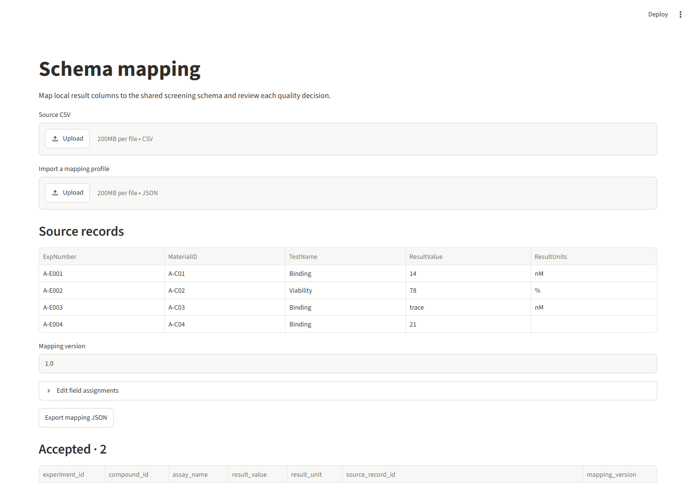

# R&D AI-Ready Data Platform

An interactive Streamlit demo for mapping synthetic screening results into a shared research schema. All example identifiers and measurements are fictional. The quality rules apply to these fixtures. This prototype has no GxP validation.

## Run locally

From the repository root in PowerShell, use Python 3.12 and the project environment.

```powershell
py -3.12 -m venv .venv
.\.venv\Scripts\python.exe -m pip install -r requirements-dev.txt
.\.venv\Scripts\python.exe -m streamlit run app.py
.\.venv\Scripts\python.exe -m pytest -q
```

## Mapping workflow

Open Schema mapping, inspect the Alpha fixture or upload a UTF-8 CSV, and assign a source column to each required target. Import or export a versioned JSON profile to reuse the assignments. Review accepted and flagged rows before downloading a CSV or SQLite snapshot. A source row's identifier incorporates its source, input batch, position, and original content. The mapping preview checks units and numeric values and preserves the original CSV.


